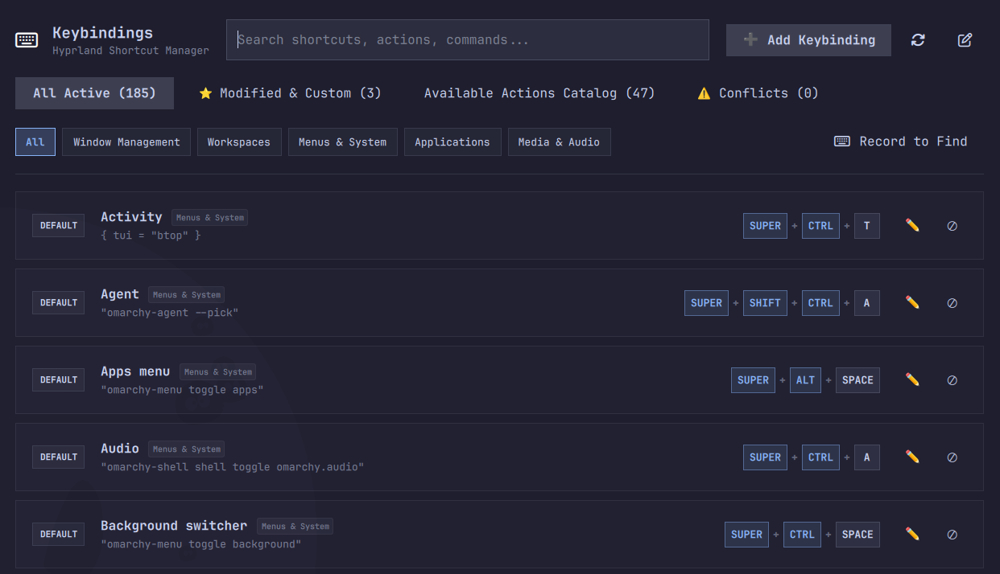
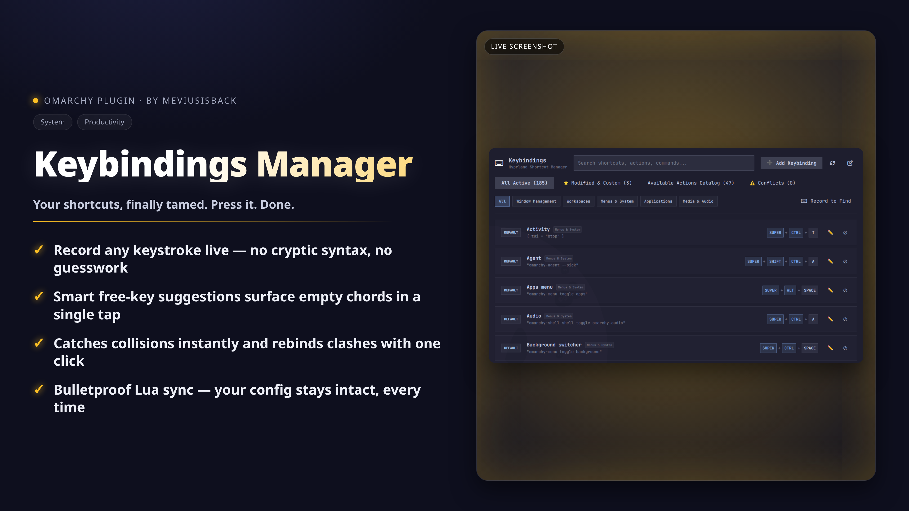

<div align="center">

# Keybindings

Version 1.0.7

**A graphical frontend for Omarchy keybindings: view, search, modify and create Hyprland shortcuts with live key recording, smart free-key recommendations, collision detection and safe Lua sync.**

[](LICENSE)





</div>

## Why

Editing Hyprland keybindings by hand means memorizing chords, guessing free combinations and hoping your Lua still parses. This plugin replaces that loop with a visual manager: see every binding sorted and searchable (Omarchy builds its workspace, group and bar-panel shortcuts inside Lua loops, which a static reader cannot see, so those are not listed), record a new chord by pressing it, get told about collisions before they bite, and let the plugin write `bindings.lua` safely — with a backup every time and a live reload, no session restart.

## Features

- **On-demand launch** — summon the floating manager anytime via `omarchy-shell shell summon meviusisback.keybinds` (or bind it to a key); as a `panel` plugin, nothing sits in the top bar until summoned.
- **Alphabetical sorting** — all active keybindings and catalog presets, strictly case-insensitive by action name.
- **Dedicated Modified & Custom section** — review all personal shortcut overrides and custom keybindings in one place, with 1-click **↺ Reset to Default** and **🗑️ Delete**. A shortcut you switched off stays listed there. Each row shows only the controls that can really work: Reset for an Omarchy default you switched off or overrode, Delete for a custom one, Enable when the file allows it. When Botty cannot read every binding in your file (a computed or escaped key, a bind nested in an `if` or inside an `hl.on(…)` body, a second statement on the line, CR line endings, a bind reached through an alias or a computed index, an unbind whose key it cannot read, a file it cannot decode) or another of your shortcuts occupies the same chord, the controls that rewrite the file are hidden on both tabs and the row carries the reason (an ⓘ that also appears in the remaining tooltips); Edit is hidden too, because every save would be refused. No control that can only fail.
- **Smart free-key recommendations** — when creating or editing an action, the modal scans the bindings the panel can see for unassigned shortcuts matching the action's first letter (e.g. `SUPER + S`, `SUPER + SHIFT + S` for Spotify) with 1-click suggestion chips.
- **Multi-method key recorder** — live keyboard capture (click to record, press any combination); modifier toggle pills (<kbd>SUPER</kbd>, <kbd>CTRL</kbd>, <kbd>ALT</kbd>, <kbd>SHIFT</kbd>); quick-key chips for common special keys (<kbd>RETURN</kbd>, <kbd>SPACE</kbd>, <kbd>ESCAPE</kbd>, <kbd>TAB</kbd>, <kbd>BACKSPACE</kbd>, <kbd>DELETE</kbd>, <kbd>PRINT</kbd>, <kbd>F1</kbd>, <kbd>F2</kbd>, <kbd>F5</kbd>, <kbd>F10</kbd>, <kbd>F12</kbd> — every other key can be recorded or typed).
- **Collision detection & 1-click rebind** — shortcut conflicts surface in real time as detailed cards with 1-click rebind options for the colliding actions.
- **Actions catalog** — pre-configured Hyprland / Omarchy window-management, workspace, media and system presets ready to bind.
- **Mouse scroll sync** — reads your scroll sensitivity multiplier (`scroll_factor`) and the natural-scroll flag (`natural_scroll`) live from the compositor (`hyprctl getoption`); the multiplier is applied to scrolling inside the panel, while the direction is already applied by libinput — the same values the [Mouse Settings](https://github.com/meviusisback/mouse-settings) plugin (`meviusisback.mouse-settings`) sets.
- **Record-to-find lookup** — press **Record to Find** next to the search bar and hit any key chord to locate its assigned action instantly (or get a 1-click **+ Create Keybinding** when it's unassigned).
- **Safe Lua sync & live reload** — writes directly to `~/.config/hypr/bindings.lua` (a `.bak` copy of the previous content sits next to the file it resolves to, dotfile symlinks are preserved, and group/world write permission on the file is cleared because Hyprland executes it) and invokes `hyprctl reload` for instantaneous application without session restarts.

## Install

```bash
omarchy plugin add https://github.com/meviusisback/keybinds-plugin --enable
```

On first launch, the plugin offers to add a **Keybindings Manager** entry to your Omarchy launcher (Setup → Keybindings → Keybindings Manager). It asks once per session — accept or dismiss — and you can toggle it anytime from the **📋 Add to Launcher** / **✓ In Launcher** button in the header bar.

## Usage

From the desktop: summon with `omarchy-shell shell summon meviusisback.keybinds` (or your launcher/keybinding), then search by shortcut (e.g. `SUPER + W`), action name (e.g. `Terminal`), category or command.

From the terminal — the `bin/` directory is **not** on `PATH` by default (Omarchy only puts `/usr/share/omarchy/bin` there). Either call the wrapper by its installed path:

```bash
~/.config/omarchy/plugins/meviusisback.keybinds/bin/omarchy-keybinds
```

or link it once into your personal bin (the wrapper resolves symlinks correctly):

```bash
mkdir -p ~/.local/bin
ln -s ~/.config/omarchy/plugins/meviusisback.keybinds/bin/omarchy-keybinds ~/.local/bin/omarchy-keybinds
omarchy-keybinds   # launch the GUI directly
```

Or summon via the shell IPC:

```bash
omarchy-shell shell summon meviusisback.keybinds
```

Note: the raw IPC exits 0 even when the shell refuses it (it answers `ok` / `unknown` — e.g. while the plugin is disabled). The wrapper turns a refusal into a visible error with the matching `omarchy plugin enable` hint, instead of exiting 0 silently.

CLI reference (full backend engine):

```bash
# List all active keybindings, presets, conflicts, and mouse settings in JSON
omarchy-keybinds list

# Create or modify a shortcut: one JSON object on stdin, never argv (binding
# commands can carry credentials, and argv is readable by other local accounts)
printf '%s\n' '{"key":"SUPER + SHIFT + B","description":"My Browser","command":"omarchy-launch-browser"}' | omarchy-keybinds set
# moving an existing binding also needs its previous row, so the old chord is freed:
printf '%s\n' '{"key":"SUPER + ALT + B","description":"My Browser","command":"omarchy-launch-browser","old_key":"SUPER + SHIFT + B","old_description":"My Browser","old_command":"omarchy-launch-browser"}' | omarchy-keybinds set
# command is required; send "" when the binding is an action-only raw Lua dispatcher.
# optional keys: action (raw Lua dispatcher), old_action, keep_disabled

# Reset a modified shortcut back to Omarchy default
printf '%s\n' '{"key":"SUPER + SHIFT + B"}' | omarchy-keybinds reset
# optional keys: default_key, description, action
# names ONE row when two bindings share a chord, and frees the default chord of a moved override

# Disable / unbind a shortcut
printf '%s\n' '{"key":"SUPER + W"}' | omarchy-keybinds disable
# optional keys: description, action

# Re-enable a previously disabled default shortcut
printf '%s\n' '{"key":"SUPER + W"}' | omarchy-keybinds enable

# Reload Hyprland configuration
omarchy-keybinds reload
```

## Requirements

- Omarchy Linux with Hyprland (bindings live in `~/.config/hypr/bindings.lua`; reload via `hyprctl`)
- Quickshell / QML shell for the graphical frontend
- Python 3.10+ (backend engine, standard library)

## Configuration

The plugin manages personal overrides in `~/.config/hypr/bindings.lua`:

- **Descriptions are text** — what you type is written as text: a Lua escape sequence (`\t`, `\n`) in a description is stored literally, not expanded.
- **Custom / rebound keybindings** — generated with `o.bind(...)` directives (or `o.bind_toggle(...)` for a toggle row, whose third argument stays the toggle name, and `o.bind_hold(...)` for a push-to-talk row, whose stop action and options are kept as written).
- **Disabled keybindings** — generated with `hl.unbind(...)` directives.
- **Safety backups** — the previous content is copied to `bindings.lua.bak` (beside the resolved target, so symlinked dotfiles work) before every rewrite; the very first write, when there is no file yet, has nothing to back up.
- **Comment preservation** — comment lines and manual custom blocks in `bindings.lua` are preserved; a comment left at the END of a line the plugin rewrites goes with that line (the plugin writes one statement per line).

## How it works

The Python engine (`backend/keybinds_manager.py`) parses the Omarchy default bindings plus your `bindings.lua`, evaluates conflicts and mouse-scroll sync, and writes changes back via atomic rename: chords that could break out of a Lua literal are rejected and every plain command is escaped into a Lua string. Raw Lua dispatchers (`hl.*`, `o.*` helper calls such as `o.launch_terminal()`, and `{...}` tables) are inserted only from the dispatcher slot — the built-in catalog presets and the binding being edited — and each one is checked before it is written (one balanced call, table, or `function ... end` whose body closes exactly at the end: no newlines, comments, trailing escape, second statement, control bytes, or more than the command limit). Text typed into the command field is only ever written as a literal command — never code; when the dispatcher slot is empty, a value that looks like raw Lua is refused with an error instead, so an application's `.desktop` `Exec` cannot either. A write that cannot be completed is refused and reported as such, never as saved. The QML panels (`KeybindsPanel`, `EditKeybindDialog`, `KeyRecorder`, `KeyBadge`) are the frontend. Local-only: no network access, no telemetry, and the only files read are your keybinding files, Omarchy's default bindings (`/usr/share/omarchy/default/hypr/bindings`), the Omarchy menu definition (`~/.config/omarchy/extensions/omarchy-menu.jsonc`, which the plugin adds its own Keybindings Manager launcher entry to; because it is JSONC, the file is re-serialised on that change, so its comments and hand-formatting are lost) and the desktop entries used to name applications (`~/.local/share/applications`, `/usr/share/applications`, `/usr/local/share/applications`) — the interactive recorder captures keystrokes in memory just to display the pressed chord; nothing is persisted or transmitted.

Verify with `python3 -m unittest discover -s tests -p "test_*.py"` — 244 tests covering key normalization, Lua-literal escaping, statement-aware editing, comment handling, unbind detection, backup contents, bounded reads, in-place edits on a shared chord, the single certification shared by panel and writer (including computed indexes, nested binds, unreadable unbind chords and undecodable files), the stdin-only write contract (no binding content in argv), the shared subprocess output budget with group kills, and the guards that must fail closed.

## Removal

```bash
omarchy plugin remove meviusisback.keybinds
```

Keeps your personal `~/.config/hypr/bindings.lua` untouched.

## License

MIT — see [LICENSE](LICENSE).
